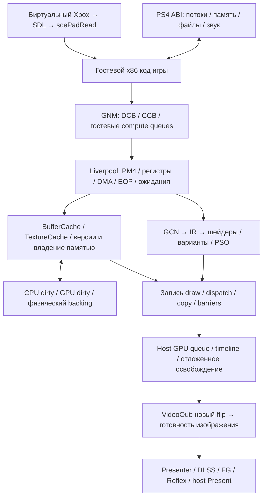

# Модель эмуляции для переноса в ядро NativeDX12

Это сохранённое инженерное знание проекта. При следующих изменениях ядра
использовать механизм и его условия корректности, а измерениями проверять
реализацию. Запрос пользователя 2026-10-11: сначала глубоко понять Vulkan,
затем перенести подходящие механизмы в нашу DirectX-сборку.

## Основания и границы знания

1. Установленный Vulkan: `974f8c21-dirty`, exe SHA256
   `7d350796bdd27515f85951226fed73a7167487f0eb5b590e1d0cfb2504eab773`.
   [RESEARCH.md](RESEARCH.md) отделяет его реальные логи от анализа публичной
   базы `974f8c211c5c6b277f8da2fadcd30c4d770cb27b`.
   Точный dirty patch недоступен.
2. Отдельная Vulkan-проба: исходники
   `c7e065d1b415be16c23e260a21f1dd8bbfc4cb57` плюс ограниченные измерительные
   вставки, exe SHA256
   `7a9811b94ab1b5da3dade41c7af5720c0916e064b10d66082b09e159ca4dc724`.
   [PINNED_PROBE.json](PINNED_PROBE.json) хранит результаты и происхождение.
   Это другая версия; её числа не приписывать установленному dirty exe.
3. Код NativeDX12 уже содержит F1–F3, high-memory, GPU copy HLE и часть
   механизмов владения. Их наличие не означает полную функциональную или
   производительную эквивалентность Vulkan. Не реализовывать их заново.

## Сквозной путь игрового кадра

Гостевой CPU и GPU-шейдеры — разные пути. Linker загружает ELF/SPRX,
разрешает импорты и TLS, использует PS4 SysV ABI и передаёт управление
гостевой x86 entry. Совместимый x86 код выполняется на host CPU с необходимой
поддержкой гостевой среды; это не основание выдумывать общий CPU JIT или его
кеш. GCN-программы гостевого GPU отдельно переводятся в IR и host shaders.

GNM принимает PS4 command buffers. Liverpool интерпретирует PM4, обновляет
регистры, выполняет DMA/copy и гостевые условия ожидания. Гостевая compute
очередь сама по себе не доказывает использование отдельной host async-compute
очереди. В установленной публичной базе DrawPipe дополнительно разделяет
декодирование, снимки ресурсов и отложенную запись; наличие этой конкретной
реализации не переносить на старую pinned-пробу без проверки.

## Правила памяти

| Событие | Обязательная семантика | Следствие для DirectX-ядра |
|---|---|---|
| CPU меняет гостевую страницу | Изменение должно инвалидировать доказательство неизменности до повторного GPU использования | Нельзя сохранять `cpu_watched` после снятия защиты, смены backing или записи через физический alias |
| GPU читает неизменённый буфер | Существующее размещение и данные остаются пригодными | Повторный bind не требует нового resource, полного `memcmp` или upload |
| CPU dirty → GPU read | Загрузить изменённые диапазоны; после согласования сохранить доказательство их версии | Учёт страниц/диапазонов должен отделять размер запрошенного view от реально скопированных байтов |
| GPU пишет буфер | Сохранить GPU dirty диапазоны и последний GPU user/fence | Read-only bind последующего потребителя не переводит данные обратно в CPU-владение |
| CPU читает GPU dirty диапазон | Дождаться соответствующей записи, скачать необходимые данные, записать актуальный backing | GPU residency не позволяет вернуть устаревшую CPU-копию; Relaxed не означает отказ от readback |
| HLE или ОС пишет через backing alias | Такое изменение тоже участвует в coherence | Защита виртуального адреса не перехватит запись через другой физический alias; нужны уведомления владельца памяти |
| Перекрываются buffer и image | Согласовать последнего писателя, формат, layout и диапазон | Нельзя независимо считать обе CPU-копии актуальными или бесконтрольно сбрасывать всю область |
| Unmap / remap / права доступа | Старая версия backing прекращает существовать | Старый кеш не имеет права записать данные в новое отображение того же адреса |
| Resource больше не нужен | Освободить после последнего реального GPU использования | Число последнего submit не заменяет fence ещё открытого command list |

Vulkan отделяет виртуальную arena от физической residency. Missing blocks
получают backing, существующие остаются. Учёт модификаций использует страницы
и более крупные области; синхронизация перечисляет dirty диапазоны, а не
сравнивает каждый повторно запрошенный буфер целиком. Для небольших CPU-only
данных существует stream/staging путь. GPU-изменённые источники текстур могут
остаться на GPU: detile/retile compute преобразует PS4 layout, затем данные
попадают в image. В отдельных image путях Vulkan всё же применяет хеширование;
утверждение «Vulkan никогда не хеширует» неверно.

Гарантия write-watch требует закрыть промежуток между проверкой данных и
установкой защиты. Установка защиты до сравнения тоже требует проверки:
reentrant readback/alias callback может снять её; CPU writer может ждать
execution lock; активный mapping может измениться. Это не разрешение просто
удалить второй `memcmp`. Ранее опробованная frozen-watch оптимизация NativeDX12
прошла узкие fixtures, но не получила подтверждения в игровом мире и остаётся
отложенным экспериментом.

## Шейдеры, состояния и специализированные операции

* GCN code и runtime specialization определяют вариант шейдера. Стабильный
  вариант повторно используется; изменение только адреса ресурса не должно
  заставлять переводить тот же шейдер заново.
* Pipeline key включает реальные render state, форматы, sample count и стадии.
  Повторное использование shader не доказывает, что новый PSO не создавался.
* Обычные 16/32-bit индексы Vulkan связывает как buffer + offset + index type.
  Особые primitive/restart случаи проверяются отдельно; нельзя считать
  каждый indexed draw необходимостью CPU-конвертации индексов.
* Узнанный copy shader `0xfefebf9f` имеет специальный HLE-путь. Управляющие
  структуры читаются CPU, а payload может копироваться GPU. Число HLE batches
  не равно числу исходных guest dispatches или объёму данных.
* Metadata clear, image clear/copy и обычный compute имеют разные семантики.
  В pinned Vulkan `DispatchDirect` может закончиться в HLE до host dispatch.
  Поэтому один счётчик dispatch не описывает всю работу.
* HTILE/CMASK/FMASK — гостевые metadata/layout и состояния. Их обработка
  требует формата, coverage, clear value, stencil/depth и alias semantics;
  пропуск неизвестного compute не является корректной оптимизацией.

NativeDX12 уже использует общий GCN frontend/IR, SPIR-V intermediate и
существующий DX12 converter; `CompileGuestShader` находится в
`src/video_core/renderer_d3d12/guest_shader.cpp`. Переносить результаты
ресурсного анализа и правила specialization в этот путь, сохраняя его ABI и
корректность binding. DLSS не заменяет этот перевод.

## Очереди, гостевые сигналы и показ

1. Guest `EOP`/`WriteData` и CPU-visible labels имеют адрес, значение, маску и
   порядок. Они не являются автоматически игровыми кадрами.
2. Завершение CPU-записи command buffer не означает завершение GPU. Состояния
   decode, record, submit, GPU-complete и Present нужно хранить раздельно.
3. Fence/timeline идентифицируется парой **домен очереди + значение**. В пробе
   renderer и presenter имели разные scheduler объекты. Одинаковые числовые
   значения в этих доменах не обозначают одну и ту же работу.
4. Новый VideoOut flip связан с конкретным подготовленным изображением и
   fence его готовности. Повторный показ того же изображения не создаёт новый
   гостевой кадр. Callback, наблюдающий завершение fence, может выполниться позже
   реального аппаратного завершения.
5. CPU return из host Present не доказывает ни GPU completion, ни отображение
   на экране. FG ×4 создаёт дополнительные выходные изображения; Reflex
   регулирует host timing/latency. Это внешняя работа эмулятора после гостевого
   рендеринга; в Bloodborne нет нативной DLSS/FG/Reflex интеграции.

## Другие взаимодействия ядра

XInput feeder создаёт собственный виртуальный Xbox через существующий клиент,
SDL назначает его контроллеру, `GameController::ReadStates` и `scePadRead`
преобразуют состояния в PS4 pad ABI. XInput index, SDL assignment и guest slot
проверяются отдельно. Для игры использовать существующий геймпадный путь,
проверять release-to-neutral и реальное изменение изображения/состояния.

Kernel HLE связывает guest mutex/condition/semaphore, host threads и игровую
память. Файловое чтение записывает в гостевой буфер и должно участвовать в
memory coherence; page protection и physical backing нельзя обходить без
уведомления. Audio HLE передаёт блоки guest audio в host backend и имеет свои
потоки/ожидания. По имени самого загруженного потока нельзя определить
функцию, критический путь или причину задержки игрового кадра.

## Карта переноса и проверок

| Механизм | Текущие точки NativeDX12 | Проверка следующего изменения |
|---|---|---|
| Dirty CPU страницы и watch proof | `rasterizer.cpp`: `PrepareShaderBuffers`, `InstallCpuWatch`, `ReleaseCpuBufferWatches`; `guest_buffer_access.h`; `page_watch.h` | Store на странице, store через backing alias, reentrant release, новый backing по старому адресу; GPU должен увидеть точное новое значение |
| GPU ownership и bounded readback | `ResolveGpuBuffers`, `dirty_ranges`, `GuestBufferAccess::CheckBacking` | CPU reads после GPU write, buffer↔image aliases, read-only reuse, частичное перекрытие, сохранение нетронутых байтов |
| Стабильное размещение и retirement | `Find`, `RetireBuffer`, `command_scheduler.cpp` | Разные views одного backing, открытый command list, fence completion, eviction/remap; отсутствие преждевременного освобождения |
| PS4 копии и metadata | `guest_compute.cpp`, `guest_rasterizer.cpp`, существующие DMA/metadata fixtures | Перекрывающийся memmove, unaligned payload, GDS, formats, mip/layers, clear/depth/stencil; неизвестный shader идёт в общий путь |
| Shader/PSO reuse и bindings | `guest_shader_cache.cpp`, `guest_pipeline_cache.cpp`, `guest_shader.cpp` | Новый resource address при том же варианте, изменение specialization/render state, индексы 16/32 и restart |
| Frame readiness и guest ordering | Guest VideoOut/PM4 integration, `CommandScheduler`, существующий frame capture | Раздельные record/submit/completion, новые и повторные flips, EOP без flip, события из разных fence domains |

Проверенная адаптация DX12 (2026-10-12): CPU store освобождает только грязные
страницы, остальные сохраняют proof. Перед частичным сравнением защита дырок
восстанавливается; pending proof не является cache hit и снимается при nested
alias write/exception. Повторный TrackReadOnly проверяет новые дырки через Track,
не сканируя уже защищённые чистые OS regions. Core remap/protection notifications
должны по-прежнему освобождать proof; GPU ownership transfers валидируют защиту.

Обычные индексы 16/32 участвуют в общей подготовке resident shader buffers.
IA + shader read требуют объединения D3D12 read states. UAV + IA нельзя объединять:
индексы копируются на GPU в отдельный pooled buffer перед shader writes этого
draw. Allocation lease удерживается до retirement команд; пока lease жив,
pool не переиспользует ресурс. Endian/primitive/restart conversions сохраняют
существующий CPU fallback. Эти контракты покрыты 220 native regressions; ядро
собрано, мир загрузился. Финальный пассивный замер 1.587158 completed frames/s
имеет ограничения в BENCHMARKS.md; полноценная новая gameplay-приёмка открыта.

Приоритет следующей работы: атрибутировать оставшиеся большие materialization,
overlap retirement и reconciliation waits. Не сужать GPU ownership по одним
счётчикам объёма; новое изменение должно сохранять все строки таблицы памяти.

Приёмка: узкие проверки ошибочных interleavings → обязательный native suite →
изолированная Bloodborne-сцена с XInput → реальные новые GPU-completed flips до
и после при одинаковых game/profile/save/patch/cache условиях → повторение.
Последнее ограничение пользователя запрещает Computer Use и автоматический
gameplay input, пока он использует ПК; проверки ограничены запусками игры.
Функциональные сценарии боя, смерти/respawn и длительной загрузки ещё открыты.
Никакая запись этого документа не означает, что весь перенос уже выполнен.
