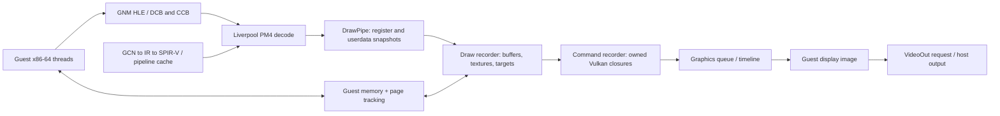

# Bloodborne Vulkan emulation: execution, ownership and measured dependencies

## Compatible-source probe and durable core model — 2026-10-11

The [saved core contract](CORE_CONTRACT.md) connects guest execution, memory,
shader specialization, queues and VideoOut to the current native implementation.
[PINNED_PROBE.json](PINNED_PROBE.json) contains independently verified evidence
from c7e065d1b415be16c23e260a21f1dd8bbfc4cb57 plus opt-in instrumentation.
It is a different runtime/game configuration from installed 974-dirty below;
there is no installed-to-native speed ratio. Both owned probe games closed with
exit 0. Originals and immutable save seeds were preserved. The seed manifest's
config hash was already stale; copied effective configurations were normalized
and compared separately, without claiming every seed-manifest hash matched.

Existing scheduler retirement callbacks observed 7,914 new completed flips in
263.848488 s, 3,197 in 106.599407 s, and 1,718 in 57.275295 s (trace on):
29.9945 / 29.9908 / 29.9955 flips/s at a 30 FPS cap. Median intervals were
33.327 / 33.330 / 33.331 ms. Mean CPU in the adjacent off/on windows rose from
2.5615 to 3.1924 cores (~24.6%). Unchanged capped FPS is not zero overhead;
changed callback-observation lag is not reduced GPU latency.

The trace retained 1,717 frame.ready records, all joined to actual queue submit
by scheduler pointer and signal tick and to their new-frame completion identity.
5,145 of 5,146 retained primary queries join to their queue-record parent and
submit tick; one boundary/drop remains unlinked, with zero mismatched ticks.
Renderer and presenter are distinct timeline domains. Primary GPU durations
sum 9,076.713 ms (~5.2833 ms per completed flip over the window); nested detile
and dispatch timings must not be added to that sum or called an exclusive
per-frame critical path. CPU/GPU clocks are not calibrated.

Actual dirty upload sites reported 3,435,376,640 bytes in 42,520 batches; mapped
stream CPU copies separately reported 3,452,055,494 bytes in 4,131,157 calls.
The warm window had 2,095,591 resident buffer hits and no observed physical
buffer allocation or buffer-download label. RuntimeDownloadImage still occurred
17,140 times, so this does not mean no readbacks. CompileModule was absent after
warmup, but graphics/compute pipeline-creation and TextureCache TickFrame hooks
were missing: their counts are unknown, not zero. Short compute.shader detail
was filtered; aggregate dispatch counts cannot establish shader identities.

Opcode counts include 14,541,739 SetContextReg, 7,535,797 SetShReg, 905,767
AcquireMem, 577,111 EventWriteEop and 302,785 WaitRegMem. EOPs are not frames.
Queue kinds 0/1/2 mean constant-engine/graphics-DE/guest-compute decoders.
40,144,450 trace bytes, 1,482 lost detailed events, 211,410,723 intentionally
filtered short details and zero aggregate overflow are recorded separately.
This is bounded internal evidence, not exhaustive resource-version attribution.

XInput and visible state verified rotation, movement, a chalice interaction prompt
and Workshop entry. Attack/roll reports were acknowledged; enemy hits,
Gherman dialogue, death and respawn are not confirmed. Full native engineering
acceptance continues after this research checkpoint. Later frame-writer fixes
for elapsed-time marker polling, explicit storage cap and final drain passed
separate red/green smoke tests; the measured probe's compiled-header hashes are
preserved and do not claim those later fixes were in its binary.

Research checkpoint, 2026-10-11. The current priority is understanding the working
Vulkan emulator before returning to production DX12 changes. This checkpoint
does not complete the accepted performance-recovery engineering cycle.

## Executed reference

Three isolated runs used byte-identical copies of the installed
`F:/Apps/shadPS4-DLSS-DLAA-1.8.4/shadPS4.exe`, SHA256
`7d350796bdd27515f85951226fed73a7167487f0eb5b590e1d0cfb2504eab773`.
The executable reports `974f8c21-dirty`. Public base source is pinned to
`974f8c211c5c6b277f8da2fadcd30c4d770cb27b`; the producer's dirty patch remains
unavailable. Runtime measurements describe the installed executable. Algorithms
below describe the public base and are distinguished from runtime evidence.

Bloodborne CUSA03173 1.09, eboot SHA256
`d65f0b4f01d59166aed16f8604196d8b7dd805abbf0758b356e8f1354c9429f9`.
Copied original home/save seed manifest hash:
`01ab8a9bae5b5f058a8bfcab3dd0a680a01eec3d1deb0959d094bd2df7407602`.
Both diagnostic runs used this same seed. Cache started empty; measurement began
after entering Central Yharnam and waiting. Warm cache contents were not hashed
while running. Original patches, including 60FPS++ and 2560x1440 rendering,
were copied. Relaxed readbacks=1, linear image readbacks off, extra direct memory
4096 MiB. Test windows were 1920x1080 windowed; requested DLSS output remained
3840x2160, FG x4, Reflex sleep enabled. This is not a matched DX12 benchmark.

| Run | UTC launch–exit | Purpose / actual outcome |
| --- | --- | --- |
| vulkan-installed-1, PID 6556 | 16:08:12–16:13:58 | Installed runtime; movement/camera observed; teardown exit 0xC0000409 |
| vulkan-installed-diag-1, PID 8732 | 16:14:19–16:25:50 | Built-in CPU/queue diagnostics, stage GPU profiling off; teardown exit 0xC0000005 |
| vulkan-installed-gpu-1, PID 19988 | 16:33:20–16:48:32 | Built-in detailed GPU labels, separate diagnostic run; teardown exit 0xC0000409 |

All exits followed ordinary Alt+F4, without forced process termination. Logs show
renderer/FG teardown and cache dumping, but the exception modules/causes remain
unknown. These exits are failures, not successful lifecycle validation. Collectors
stopped with process exit, zero skipped sampling intervals. All virtual devices
were removed. A later hash check matched all 17 copied original home files.
Original executable, DLLs, shortcut and settings were not replaced.

## What actually executes the PS4 program

The public loader relocates guest modules and resolves imports to guest firmware
modules or HLE functions. On x86-64, `RunMainEntry` prepares the guest ABI stack
and jumps to the loaded entry address. Guest thread creation starts native host
threads and enters the guest routine on its guest stack. This is distinct from
the GCN shader recompiler; assuming a generic CPU JIT accounts for the CPU work
would misidentify this implementation.

Kernel HLE maintains guest direct/flexible-memory allocations, virtual mappings,
protection, thread state and synchronization. GPU mappings notify the rasterizer;
mapping replacement/unmap must synchronize and invalidate the corresponding
resource state. The emulated PS4 shared address space and Vulkan device memory
are different copies with explicit ownership. Host RAM/VRAM counters do not
describe which copy is authoritative.

Sources: [loader and guest entry](https://github.com/eFMann/shadPS4-Bloodborne-DLSS-FSR/blob/974f8c211c5c6b277f8da2fadcd30c4d770cb27b/src/core/linker.cpp#L41),
[guest thread creation](https://github.com/eFMann/shadPS4-Bloodborne-DLSS-FSR/blob/974f8c211c5c6b277f8da2fadcd30c4d770cb27b/src/core/libraries/kernel/threads/pthread.cpp#L284),
[memory mapping](https://github.com/eFMann/shadPS4-Bloodborne-DLSS-FSR/blob/974f8c211c5c6b277f8da2fadcd30c4d770cb27b/src/core/memory.cpp#L513).

## Submission and recording order

1. `sceGnmSubmitAndFlipCommandBuffersForWorkload` validates DCB/CCB arrays,
   patches the guest flip packet and enqueues command spans into Liverpool.
   `WaitGpuIdle` gates the emulator's submission lock; its name does not imply
   an unconditional Vulkan device-idle operation.
2. Liverpool processes graphics and mapped guest compute queues as resumable
   tasks. Guest compute queues do not establish separate asynchronous host GPU
   queues. Register waits can yield; special VideoOut label waits have their own
   path.
3. Stage A (`GpuCommandProcessor`) decodes PM4 and selects pipelines. A draw
   packet owns changed register blocks, userdata and arguments. Stage B
   (`GpuDrawRecorder`) applies those snapshots and binds resources. Stage C
   (`GpuCmdRecorder`) records deferred Vulkan closures, whose captures must own
   their data. These three named threads were observed in the installed runtime.
4. Small readonly constants can be copied ahead into a ring. Overlapping pending
   GPU writes exclude premature CPU prefetch. Vertex bindings can be prepared
   ahead. State memoization reuses an open render pass and image lookups.
5. `DrainDrawPipe` protects state access by stage A, write/read fault handling and
   guest command-buffer lifetime. Liverpool drains recording before retiring a
   command task, because the guest can then reuse its command memory. This is
   CPU recording completion, not physical GPU completion.
6. Ordered EOP/WRITE_DATA callbacks copy packet bytes and preserve recorder order.
   Pending fence matches use address, value/mask, comparison and packet progress;
   they do not permit arbitrary GPU waits to be removed.

Sources: [GNM flip patch/submission](https://github.com/eFMann/shadPS4-Bloodborne-DLSS-FSR/blob/974f8c211c5c6b277f8da2fadcd30c4d770cb27b/src/core/libraries/gnmdriver/gnmdriver.cpp#L2092),
[Liverpool ordering](https://github.com/eFMann/shadPS4-Bloodborne-DLSS-FSR/blob/974f8c211c5c6b277f8da2fadcd30c4d770cb27b/src/video_core/amdgpu/liverpool.cpp#L107),
[draw packet pipeline](https://github.com/eFMann/shadPS4-Bloodborne-DLSS-FSR/blob/974f8c211c5c6b277f8da2fadcd30c4d770cb27b/src/video_core/renderer_vulkan/vk_rasterizer.cpp#L2640),
[owned command recording](https://github.com/eFMann/shadPS4-Bloodborne-DLSS-FSR/blob/974f8c211c5c6b277f8da2fadcd30c4d770cb27b/src/video_core/renderer_vulkan/vk_scheduler.h#L504).

## Buffer ownership: why another binding need not recopy data

Public BufferCache uses sparse virtual arenas, 4 GiB of virtual address space per
arena page. Physical backing is allocated only for missing blocks; minimum block
size is the larger of the device requirement and 16 KiB. Joining adjacent arenas
rebinds backing and updates the GPU-address table. Sparse binding timeline waits
become submission dependencies. Virtual arena size is not a physical allocation.

CPU/GPU modified-page bitsets track 4 KiB pages within larger regions. Upload
enumeration visits CPU-modified spans, consolidates copies and establishes write
protection. Readonly clean-page checks can skip the region lock. The source's
ordering argument is that a guest write sets the dirty bit in the fault handler
before the store and submission happens before the consuming draw. Preserve
this ordering and the page-watch proof when designing the DX12 equivalent.

Ordinary 16/32-bit indices bind the cached buffer handle plus guest offset and
native index type. Small readonly non-GPU-dirty buffers may use the stream ring;
larger resources use arena backing. There is no mandatory full CPU conversion of
ordinary index arrays in this path. Unsupported primitive/format cases require
their own fallback analysis.

Guest writes drain DrawPipe and invalidate both buffer and texture ownership.
When a CPU access overlaps GPU-written bytes, the readback path enumerates GPU
dirty intersections within a bounded window, copies to cached staging, waits for
the submitted work, writes guest backing and clears dirty ownership. Relaxed
mode is not equivalent to disabling all readbacks. The base also contains a
wide write-fault helper, but the rasterizer does not use it here: its comment
records that broader unprotection caused extra uploads. Do not copy a helper or
an upstream performance claim without checking its active caller.

Sources: [buffer acquisition and backing](https://github.com/eFMann/shadPS4-Bloodborne-DLSS-FSR/blob/974f8c211c5c6b277f8da2fadcd30c4d770cb27b/src/video_core/buffer_cache/buffer_cache.cpp#L185),
[dirty-page upload selection](https://github.com/eFMann/shadPS4-Bloodborne-DLSS-FSR/blob/974f8c211c5c6b277f8da2fadcd30c4d770cb27b/src/video_core/buffer_cache/memory_tracker.h#L89),
[ordinary indices](https://github.com/eFMann/shadPS4-Bloodborne-DLSS-FSR/blob/974f8c211c5c6b277f8da2fadcd30c4d770cb27b/src/video_core/renderer_vulkan/vk_rasterizer.cpp#L1213).

## Textures, shaders and recognized compute work

Texture lookup includes image/view/subresource state and aliases. Dirty refresh
does not blindly replace an authoritative GPU copy. Tiny `MaybeCpuDirty` images
have a bounded hash check; GPU-modified mip protection can hash mip data to
prevent accidental CPU reupload. Thus Vulkan does use hashing in specific
texture paths, even though clean shader-buffer acquisition avoids whole-range
comparison. GPU-dirty buffer sources remain on GPU; CPU sources use staging.

PS4 tiled image data is detiled by specialized compute pipelines into linear
device-local staging, then uploaded to a host image. Parameters include format,
block-compressed geometry, bank swizzle and mip layout. The installed log records
2,404 command-recorder synchronizations at `tile_manager.cpp:227` in one roughly
10-second interval. That source line enters direct command-buffer recording in
`DetileImage`; it confirms this path is exercised. It counts synchronizations at
that site, not all detile calls, bytes or GPU detile time.

Guest GCN shader instructions are decoded into control flow and IR; resource
discovery/patching, SSA and lowering passes precede SPIR-V generation. Pipeline
keys include shader permutations and runtime state. Existing modules/pipelines
are reused; new visible content can require compilation. Startup compilation
and first allocation hitches must be separated from warm gameplay.

The recognized copy shader (`fefebf9f` in the base source) is replaced with an HLE
copy implementation. A control table describes source/destination regions.
Batches bound their source/destination envelopes to 64 KiB, acquire BufferCache
resources and maintain hazards. Batches of at least eight dword-aligned regions
can use one host compute dispatch; other batches fall back to buffer copies.
This is semantic substitution of a known shader, not skipping its writes.
Measured copy-HLE GPU labels count batches/segments, not guest shader dispatches
or copied bytes.

Sources: [texture refresh](https://github.com/eFMann/shadPS4-Bloodborne-DLSS-FSR/blob/974f8c211c5c6b277f8da2fadcd30c4d770cb27b/src/video_core/texture_cache/texture_cache.cpp#L704),
[GPU detiling](https://github.com/eFMann/shadPS4-Bloodborne-DLSS-FSR/blob/974f8c211c5c6b277f8da2fadcd30c4d770cb27b/src/video_core/texture_cache/tile_manager.cpp#L196),
[GCN translation](https://github.com/eFMann/shadPS4-Bloodborne-DLSS-FSR/blob/974f8c211c5c6b277f8da2fadcd30c4d770cb27b/src/shader_recompiler/recompiler.cpp#L69),
[shader reuse/permutations](https://github.com/eFMann/shadPS4-Bloodborne-DLSS-FSR/blob/974f8c211c5c6b277f8da2fadcd30c4d770cb27b/src/video_core/renderer_vulkan/vk_pipeline_cache.cpp#L655),
[copy-shader substitution](https://github.com/eFMann/shadPS4-Bloodborne-DLSS-FSR/blob/974f8c211c5c6b277f8da2fadcd30c4d770cb27b/src/video_core/renderer_vulkan/vk_shader_hle.cpp#L136).

## Actual tagged VideoOut dependency chain

The built-in timing CSV also records guest GNM/VideoOut events. Source inspection
shows `sceVideoOutSubmitEopFlip` captures the current game tag by value in the EOP
interrupt callback. `SubmitFlip`, the request queue and presentation callback
carry that tag. Events were joined by the actual nonzero tag, not proximity to
an unrelated Present event.

`flip_submit → flip_ready → flip_dequeue → flip_present`

`game_submit` timestamps the end of the HLE submit call, not the whole guest CPU
frame. `flip_ready` means image preparation/submission is ready for VideoOut,
not that this image has completed on GPU. `flip_present` ends on return from the
host Present function, not display scanout. Untagged pool/fence/acquire scopes
were retained as window distributions; they were not assigned to nearby flips.

Neutral stationary window, PID 8732, **16:16:46.937269–16:18:11.083149 UTC**:

| Measured quantity | Result |
| --- | --- |
| Duration | 84.145879 s |
| Unique tagged flip submissions / complete tagged chains | 5,049 / 5,049 |
| Flip submission cadence | 60.0029/s; not GPU-completed guest FPS |
| Submission interval median / P95 | 16.659 / 17.155 ms |
| Submit → ready median / P95 | 4.575 / 4.890 ms |
| Ready → VideoOut dequeue median / P95 | 24.291 / 25.785 ms |
| Submit → host Present return median / P95 | 29.158 / 30.654 ms |
| GPU-completed guest FPS / full guest CPU critical path | NOT MEASURED |

Selected joins have no missing stage, repeated nonzero stage tags or negative
latencies. Whole CSV retains one malformed final row and has no explicit drop
counter: do not claim zero global event loss. QPC/UTC sample pairing deviation
P95 is 0.0877 ms; GPU clock was not calibrated to UTC. Full capture includes
menus, loading and transition; it is not a stationary benchmark as a whole.

Sources: [captured EOP tag](https://github.com/eFMann/shadPS4-Bloodborne-DLSS-FSR/blob/974f8c211c5c6b277f8da2fadcd30c4d770cb27b/src/core/libraries/videoout/video_out.cpp#L352),
[request and presentation tag propagation](https://github.com/eFMann/shadPS4-Bloodborne-DLSS-FSR/blob/974f8c211c5c6b277f8da2fadcd30c4d770cb27b/src/core/libraries/videoout/driver.cpp#L285).

## Internal runtime evidence and its units

One retained installed-runtime diagnostic block starts at stdout line 5169:

| Counter | Observed | Meaning / limit |
| --- | --- | --- |
| Draws per OnSubmit frame | 1,743 | Actual draw counter; not indexed/indirect breakdown |
| Queued packets | 137,635/s | Logger calls these draws/s, but source counts DrawPipe packets |
| Open render pass reuse | 90% | Memo hits, not omitted draws |
| Image lookup memo | 97% of 986,446 lookups/s | Avoided lookup work; not texture upload rate |
| Constant ring copies ahead | 591,530 buffers/s | Buffer bindings/copies, not hardware bandwidth |
| Vertex inputs prepared ahead | 104,089/s | Preparation counter |
| Clean readonly upload checks skipped | 238,537/s | Dirty-page checks bypass region lock; not skipped required transfers |
| Guest write faults | 27,329/s | Ownership invalidation remains active |
| Page protection | 30,356 calls/s, 283,193 pages/s, 4.6% of one core | Calls can cover several pages; not unique dirty bytes |
| Draw-recorder sampled cost | 2.45 us/draw | Sampled 1-in-8; not total emulator CPU cost |
| Draw-scheduler timestamps | 10.87 ms/frame, two submissions/frame | Includes its DLSS hooks; not guest-only GPU time |

The same block reports ~7.95 million deferred recording closures and 59,499
direct closures per interval. Its command-buffer callsite counts identify
recording synchronizations, not deferred jobs per source site. Raw blocks lack
UTC timestamps, so this block is not labelled as exactly the stationary window.

Separate GPU-label diagnostic run retained three complete publication-window
blocks after excluding the first partial window. It observed 219.5–220.1 copy-HLE
segments/frame, charged 1.047–1.250 ms/frame; guest compute labels include
`3d5ebf4e` with 58,880x1x1 groups and `e2c27f0c` with 1x1x1 groups. Render-pass
labels include six color attachments plus depth at 2560x1440, alongside half-size
passes. These labels confirm exercised work; shader hashes alone do not name an
engine feature such as skinning or culling.

GPU labels charge time until the next ALL_COMMANDS timestamp, including
intervening copies/barriers/gaps. Only the top 30 labels are printed; the query
slice has a limit. Detailed profiling ends rendering and may wait for old query
results. It is diagnostic evidence, not clean exclusive stage timing. Its
stationary submission interval P95 was 17.497 ms versus 17.155 ms in the earlier
run; one capped run per mode does not establish profiler overhead.

The logger's "GPU idle between submissions" is also approximate: upload command
buffers precede the primary start timestamp, and presenter/FG work can execute
between draw-scheduler submissions. The gap is not measured hardware idle.
The normal scheduler reads timestamp results only after its timeline has passed;
the detailed profiler uses query WAIT. Neither gives a complete per-guest-frame
GPU causal graph here.

Sources: [counter definitions](https://github.com/eFMann/shadPS4-Bloodborne-DLSS-FSR/blob/974f8c211c5c6b277f8da2fadcd30c4d770cb27b/src/video_core/renderer_vulkan/vk_rasterizer.cpp#L3022),
[submission/timing boundaries](https://github.com/eFMann/shadPS4-Bloodborne-DLSS-FSR/blob/974f8c211c5c6b277f8da2fadcd30c4d770cb27b/src/video_core/renderer_vulkan/vk_scheduler.cpp#L371),
[GPU label measurement](https://github.com/eFMann/shadPS4-Bloodborne-DLSS-FSR/blob/974f8c211c5c6b277f8da2fadcd30c4d770cb27b/src/video_core/renderer_vulkan/vk_gpu_profiler.cpp#L53).

## Output extensions and host resource observations

DLSS/FG/Reflex are emulator-side integrations. The PS4 game has no native
implementation of them. Hooks observe guest render targets/constants and prepare
host upscaled/generated output; Reflex can pace emulator submission. They can
interact with emulation timing, but do not implement PM4, dirty tracking or PS4
memory ownership. The internal FPS label, FG multiplier and Present counts are
not a substitute for native completed-frame measurement.

Presenter stores the image's ready semaphore/tick and flushes draw work. The
default frames-ahead limit waits for an older frame tick after exceeding the
queue bound. This constrains pending work and readback latency. Present submits
waits on current image readiness; a CPU return from Present is not that GPU wait
completing. VideoOut labels/vblank retirement are separate guest-facing events.
[Presenter readiness and bound](https://github.com/eFMann/shadPS4-Bloodborne-DLSS-FSR/blob/974f8c211c5c6b277f8da2fadcd30c4d770cb27b/src/video_core/renderer_vulkan/vk_presenter.cpp#L1105).

Stationary resource samples: mean CPU 4.275 core equivalents, 128 threads,
median working set 6,414,848,000 bytes and private bytes 6,111,780,864.
Selected NVIDIA process dedicated memory median 4,444,270,592 bytes. GPU engine
instances are retained separately in `RESULTS.json`; adapter-wide NVIDIA power,
clocks/utilization are separate from process counters. These do not identify the
critical path. `NexusRevolution Socket` consumed ~0.999 core and `Game:Main`
~0.969; function/causal role of the former remains unresolved. An offline owned
minidump has incomplete guest unwinding and cannot establish a busy-loop cause.

## XInput coverage and remaining requirements

Existing `tools/vulkan_reference/xinput_control.py` supplied the verified virtual
Xbox device at XInput index 0 / guest player 0. Each bounded command checked
driver readback and neutral release. A small local sequence runner waited for
the feeder's handled acknowledgement before continuing; send returning alone
was not treated as completed gameplay. Original physical pad was off.

- A: neutral Central Yharnam window recorded as above.
- B/C: four-direction movement and camera changes observed; scenario timestamps
  and 541/548 tagged submissions retained. These are short exploratory sequences.
- D: attacks/roll commands acknowledged, stamina changed; an enemy fight/hits
  were not validated. Do not mark combat complete.
- E: lamp travel Central Yharnam → Hunter's Dream visibly completed in diag-1.
  Death/respawn was not tested.
- F: sessions covered 11.5 and 15.2 minutes including menus/loading/movement.
  This is insufficient to prove absence of leaks; teardown failures remain.
- G: requested DLSS/FG settings preserved; independent generated/display IDs
  and display latency remain unavailable.

Coverage still requires exhaustive PM4 opcode counts, transfer bytes, resource
version/dependency IDs, per-frame completion fences and calibrated GPU operation
timestamps. Stage labels and callsite counts must not fill those gaps with zeros.
Continue with a pinned compatible-source Vulkan probe in an isolated profile if
the producer's dirty source cannot be obtained, explicitly retaining its revision
differences. Measure probe overhead and fix frame/dependency/drop validity before
accepting its results. This authorization was already given by the user.

For DX12, the source-backed comparison priority remains retention of page-watch
proof and stable GPU backing, followed by measured ordinary-index/detile/copy
paths. Existing F1–F3 and high-memory fixes already cover part of this area;
their implementation must not be repeated. An earlier unverified DX12 watch
experiment is parked locally outside the checkout. No new production DX12 fix
or after-FPS result is claimed by this checkpoint.

`RESULTS.json` preserves compact measurements, runtime/config/source hashes,
coverage limits and selected original log blocks. Raw logs/CSV, dumps, copied
saves, binaries, and source downloads remain under
`F:/PS4Dev/handoff/performance-recovery-20261011/`. No game assets or saves are
published. Numeric joins were checked for unique nonzero tags and valid ordering;
this is measurement validation, not native renderer regression testing.
