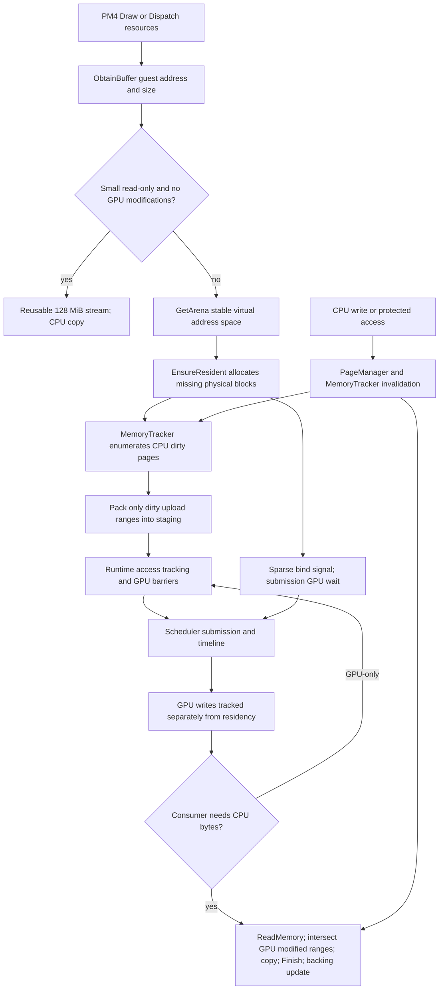

# Bloodborne Vulkan reference profiler — actual results and handoff

This delivery includes a functioning passive monitor, an exact-version isolated
instrumented build, reports, coverage/schema, source parity map and a pending
controlled comparison protocol. It does **not** claim complete internal gameplay
profiling: Mode B has not run Bloodborne; causal PM4-to-frame attribution and
graphics/copy GPU timestamps are still missing. The user's ongoing original game
remains untouched by the collector.

## A. Identity

Original executable:
`C:/Users/skei/AppData/Roaming/shadPS4QtLauncher/versions/v0.19.0 - The Shadoween special - 2026-10-02/shadPS4.exe`.
SHA256 `91eb69a59cb3ea3c35290fbd03a69718d2f6254c202ba86c6acbe1d1fc8b95f1`.
Revision c7e065d1b415be16c23e260a21f1dd8bbfc4cb57 is confirmed by the
current log, configuration and exact local Git object. CUSA03173. Driver 616.92,
RTX 5080; process counters separate NVIDIA LUID 0x170C8 and the other adapter
0x18737 (AMD Radeon Graphics), verified by read-only DXGI enumeration. The adapter
inventory also contains another NVIDIA LUID and software render driver; only
process-specific matching instances are used. Physical RAM is 66,155,397,120 bytes,
CPU is 9950X3D with 16 cores / 32 logical processors. Relaxed readback=1,
3440x1440, extra guest dmem 4096 MiB. Config hashes
match the earlier capture; guest memory setting is not a GPU cache budget.

The user independently restarted the game: old PID 14740 started 10:08:15 UTC;
new PID 18920 started 11:18:57 UTC. They are separate segments. New session ID
2514bb83e5554dadbbff6ffca4bae436; raw manifest records the start FILETIME and SHA.

Loaded-module read-only inventory found pre-existing OBS `graphics-hook64.dll`
and Kaspersky modules in the new process. Nothing was injected/unloaded by this
task. Their presence is a comparison condition, not an attributed cost or cause.

## B. Duration and scenes

| Data segment | UTC interval / samples | Validity |
|---|---|---|
| Legacy 5-second capture | 10:11:54.429–10:48:19.422; 437 rows, 2184.99s | Collector is absent; final status stayed `recording`. Final stop reason unknown. Only 430 rows with collection_session_utc have valid corrected thread sorting |
| Initial 1-second capture, PID 14740 | 10:56:58.076–11:08:36.849; 700 rows, 698.77s | CPU/PDH valid; thread descriptions lost and NVIDIA path failed 140 times. Final ~95s overlap compilation from 11:07:03; not a clean performance interval |
| Failed collector segment | 11:08:38 startup; zero rows | INVALID_MEASUREMENT: shadowed result variable caused AttributeError; excluded |
| Corrected real capture, PID 18920 snapshot | 11:30:09.407–11:37:14.178; 426 rows, 424.77s | No collector errors or skipped intervals; real named threads and 86 NVIDIA observations. Snapshot is immutable; collector continues after its cutoff |

There are explicit gaps between recordings; do not describe this as uninterrupted
monitoring from game start. No screen capture/control or scene/camera labels were
used. Asset paths in logs are loading evidence, not verified played scenes.
The corrected snapshot covers free-play, not a stationary benchmark.

## C. Actual passive metrics

Corrected 426-row snapshot only:

| Metric | Mean | Peak / limit |
|---|---:|---:|
| Process CPU core equivalents | 2.8207 | 4.4215; 8.81% mean of 32 logical CPUs |
| GPU NVIDIA process 3D engine | 88.856% | 100%; not guest FPS or compute-stage time |
| Process dedicated GPU memory | 6.8826 GiB | 7.1364 GiB |
| Process shared GPU memory | 0.1249 GiB | 0.3901 GiB |
| Process GPU total committed | 7.0076 GiB | 7.5072 GiB |
| Process working set | 8.582 GiB | 8.974 GiB |
| Process private bytes | 8.233 GiB | 8.756 GiB |
| Threads accessible to collector | 99.925 | 100; unnamed/inaccessible cases remain |

Process I/O deltas: read 1,183,327,026 bytes, write 161,534,417 bytes, other
18,240,650 bytes; page faults +315,771 including soft faults. Adapter-specific
NVIDIA power/clocks/temp/utilization/memory samples are in
`evidence/verified-NVIDIA_ADAPTER_SUMMARY.csv`; these include other processes and
must not be substituted for process VRAM or transfer bandwidth.

Collector CPU mean 0.03634 cores plus 2.84375s NVIDIA child CPU over 424.77s
(combined approximately 0.04304 cores, 0.1345% of 32 logical CPUs). Collector
working-set peak 35.71 MiB; child peak RAM unavailable. Collection wall mean
49.73ms, P99 116.21ms; jitter P99 0.836ms, max 229.65ms. No skipped intervals.
These do not establish a zero-impact profiler; instrumented Mode B overhead is
still unmeasured. Sensor-fixture overhead is separately labeled.

Initial segment is descriptively different: 1.9049 CPU cores, 53.698% process
GPU 3D, 5.0788 GiB dedicated VRAM. Different scenes/cache/time/background build
prevent interpreting the difference as a regression or a backend comparison.
Present/display/guest frame timing remains unavailable; no FPS is inferred.

## D. CPU/GPU costs that can actually be ranked

Corrected mean thread CPU equivalents, with stable thread start identity:

| Thread | TID | Mean CPU cores |
|---|---:|---:|
| NexusRevolution Socket | 25432 | 0.9990 |
| shadPS4:GpuCommandProcessor | 5468 | 0.4453 |
| Game:Main | 20844 | 0.2783 |
| unnamed | 16912 | 0.2119 |
| SDLTimer | 41048 | 0.1058 |
| GXWorker:1 | 9552 | 0.0791 |

The socket-named thread is the largest measured CPU consumer. No stacks or
producer/consumer attribution establish what it executes or whether it delays
frames; do not optimize it or blame networking/OBS based on its name. General
process CPU load does not prove a CPU bottleneck. GPU 3D activity cannot rank
detile, graphics, compute, copies or waits. Function-exclusive CPU/GPU bottleneck
rankings remain pending Mode B and trace completeness validation.

## E. BufferCache and MemoryTracker interaction

Exact source: BufferCache GetArena/EnsureResident/SynchronizeMemory/DownloadMemory;
MemoryTracker mark/unmark/ForEach*Range; RegionManager state bits/PageManager
watch protection; Runtime access intervals; Scheduler/timeline retirement.
Virtual arena pages are 4 GiB, not physical allocation size; sparse blocks are
at least 16 KiB with device alignment; dirty granularity is 4 KiB / 16 MiB regions.
Readback can widen to 512 KiB but copies intersections and still waits. Relaxed
does not mean all downloads disabled. Aliased texel/image synchronization is a
separate path. New instrumented counters distinguish requested spans, resident
hits, physical allocation and actual recorded upload/download bytes.

## F–I. Detile, commands, synchronization and cache behavior

Vulkan texture refresh can obtain GPU-resident buffer data, dispatch detile/retile,
then upload/copy native images. Ordinary indices bind BufferCache storage/stream;
GPU argument/count buffers feed indirect commands. Runtime barriers express GPU
dependencies; Flush submits, Finish submits and waits, CPU readback requires
visibility. Page ownership and residency are separate invariants.

Current log snapshot records **2337 resident records, 14 tiling pipeline creation
records and 527 preloaded pipelines**. The earlier session had 1803 / 13 / 417.
These are observed log records, not complete call or dispatch counters: duplicate
suppression and logging coverage matter. More preload records also show the cache
conditions differ. Existing errors/warnings are preserved: 30 Error, 184 Warning,
zero Critical records in this log snapshot; not evidence of device loss or crash.
No matching Application Event Log 1000/1001 was found in the queried old interval;
that does not establish a normal shutdown.

Actual upload/download volumes, detile dispatch frequency/time, direct/indexed/
indirect opcode incidence, cache miss/reconversion cost and necessary/redundant
waits have not been measured internally in the game. The isolated build has 100
declared hook sites plus payload/identity events; PM4 type-3 opcode counts survive
event drops. Optional GPU query spans cover compute and detile only. The schema
and coverage matrix state remaining omissions precisely.

## J–M. Gaps, DX12 parity and next work

Read [TELEMETRY_COVERAGE.md](TELEMETRY_COVERAGE.md),
[EVENT_SCHEMA.md](EVENT_SCHEMA.md),
[DX12_PERFORMANCE_PARITY_MATRIX.md](DX12_PERFORMANCE_PARITY_MATRIX.md) and
[CONTROLLED_AB_PROTOCOL.md](CONTROLLED_AB_PROTOCOL.md).

Significant gaps: hot stacks/ready/context switches, guest CPU vs all HLE, full
PM4-to-frame causal IDs, graphics/copy GPU timings, calibrated clocks/displayed
cadence, dirty reason/page cardinality, complete state/format census, resource
lifetimes/fragmentation/evictions, indirect shader/resources, asset decompression
and matched Vulkan Relaxed/Precise/DX12 runs. Unsupported/missing metrics are not
zero; retained event distributions are not exhaustive when events are dropped.

Next DX12 candidates: preserve CPU-watch proof and page validity (historical DX12
measured cost), ordinary resident indices and GPU detile for exercised layouts
(source/runtime candidates awaiting cost). They are not a measured Vulkan top-3.
ExecuteIndirect is conditional on demonstrated opcode incidence; stable sparse
storage is a separate larger design. No PageWatch weakening or predicted FPS gain.

## N. Reproduction, integrity and isolated build

Local root: `F:/PS4Dev/handoff/vulkan-reference-profiler-20261011`.
Immutable raw snapshot: `mode-a-verified-snapshot`; original samples remain in
their own segment directories. `evidence-integrity.json` hashes immutable local
data, including failed/synthetic segments. Repository `evidence` contains derived
counters, manifests, source instrumentation patch and local raw hashes; keys,
saves, firmware and game assets remain local. Verify hashes before reusing data.
The legacy final summary is also in `F:/PS4Dev/handoff/vulkan-observe-20261011`.

Instrumented executable `mode-b-build/shadps4.exe`, SHA256
`d28ae89412307f0297428751f8bd2778c4f0ddcadfdac8fb3fe527a2259df5ff`.
Exact base/source-file/patch hashes and build logs are in build-manifest.json.
Full Release build succeeded. Hidden `--help` check exited 0 inside the isolated
portable profile; it launched no game. Four-thread trace stress: 40,000 parent,
child, byte and opcode calls each; byte total 2,560,000, aggregate overflow zero.
It forced 127,232 event drops, retained 32,768, and correctly flagged incomplete
event rankings. Corrected 7-second sensor test passed named threads, NVIDIA/child
CPU, report parsing and graceful stop. No GPU/game correctness test is claimed.

The separate real collector PID 4004 monitors current game PID 18920, with a
checking automation. Its `active-session.json`/advancing `status.json` are the
authority after this snapshot; it is not dependent on the assistant turn staying
open. Reports finalize at normal process exit/stop/duration/storage limit.
No additional Mode B game launch is authorized yet.
